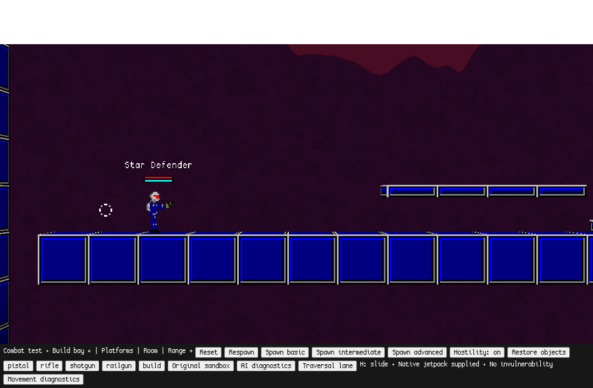
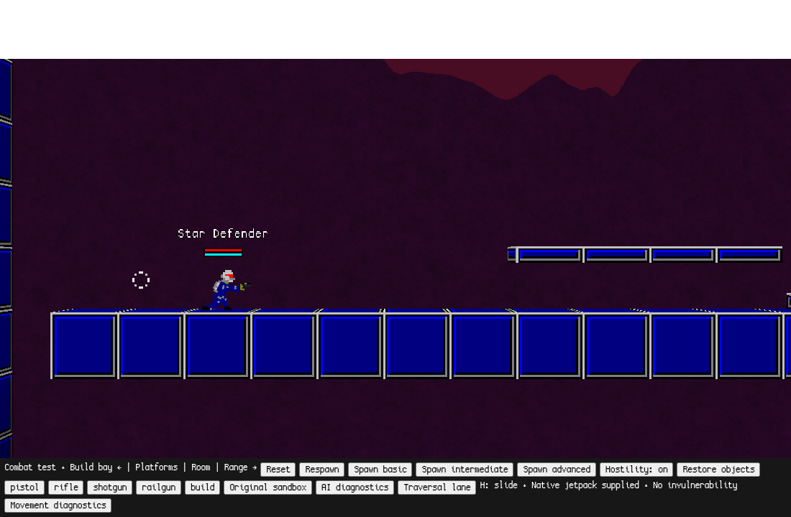
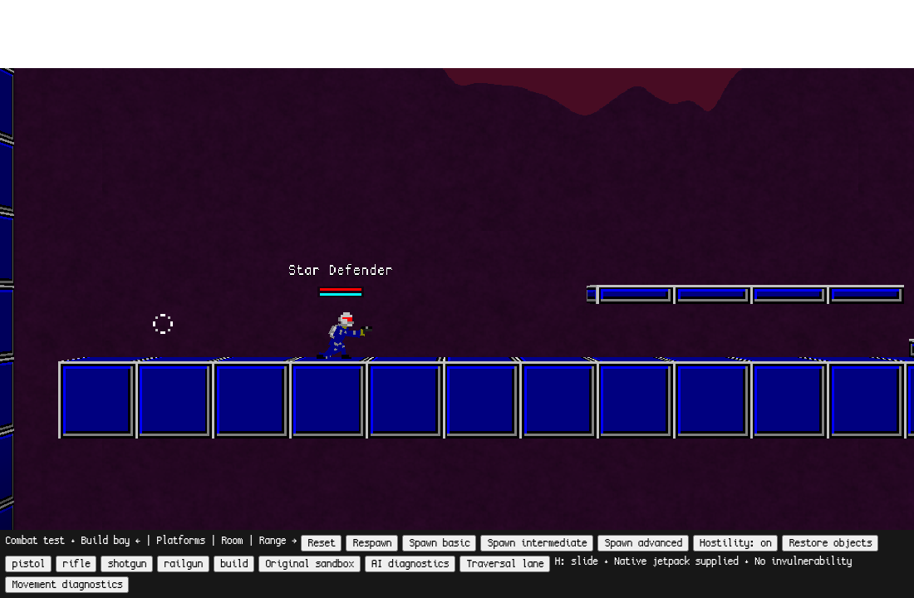
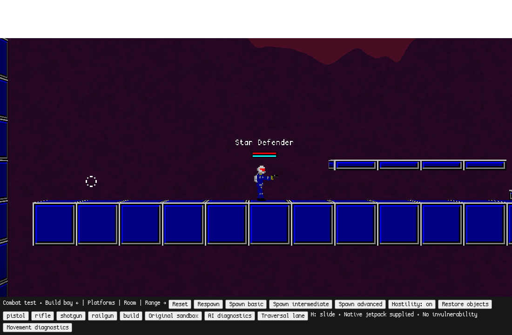

# Advanced movement — prototype frame sequence

Branch: [`advanced-movement`](https://github.com/jp8rtr59jt-coder/StarDefenders2D/tree/advanced-movement).
Built on `intelligent-combat` (`771b8b38d48a2e1225152198a3feae272a5539b6`).
The separate `visual-experiments` branch is unchanged and is not merged here.

[macOS launch instructions, controls, implementation and tuning](../../offline/ADVANCED_MOVEMENT.md).
This is an optional **gameplay prototype**, using existing artwork and the native
crouched articulated pose. It is not final character art, a new animation system
or a decision about the game's eventual setting.

The four native WebGL captures use the same viewport and fixed camera. The test
harness pauses the world clock while saving each image and advances the original
character simulation between frames. It does not substitute a drawn pose or fake
collision box. These captures demonstrate state transitions; human playtesting
is still needed to judge feel.

## Standing with the existing pistol

## Slide entry — native full crouch, momentum preserved

## Moving slide — decelerating, aim and pistol retained

## Recovery — native standing pose after sufficient clearance

## Recorded movement results

Linux, Chromium 156 with SwiftShader software WebGL, 2026-11-12. Native macOS
hardware and the subjective quality of input/animation have not been evaluated.
Raw results: [validation.json](validation.json).

- **17 movement checks passed**, including native running, H entry, no stationary
  slide, bounded deceleration, left/right movement, duration/cooldown, held-key
  suppression, weapons, jetpack transitions, death/ragdoll and three resets.
- Starting at speed 6, the slide's first integrated speed was 5.82, never exceeded
  5.82 thereafter, and covered **93.96 world units** before termination in the
  deterministic 30 Hz fixture. Ordinary slide plus final terminating step used
  27 steps (about 900 ms); screenshot/browser scheduling is excluded.
- The native 22-unit crouch box traversed the 24-unit corridor. After stopping
  inside it, crouch stayed at 1 and native standing clearance returned false.
  Jumping did not penetrate its ceiling. A wall stopped the character at
  **x = −389.00001**, outside its x = −384 face and the 5-unit half-width.
- Recovery while moving into the corridor entrance remained outside geometry.
  An 8-unit obstacle stopped the slide at x = −533.00001. An incoming speed of
  40 was capped and integrated to 7.82, rather than amplified.
- A slide ended when the actor left a raised platform; the original airborne
  movement and jetpack then remained available.
- A native enemy pistol projectile hit **while sliding**, taking health from
  **250 to 220.3**. Sliding adds no invulnerability or damage bonus.
- Original IndexedDB, combat IndexedDB and legacy localStorage sentinels were
  unchanged after the movement session quit. Movement uses its own namespace.
- No page exceptions or external network requests were recorded in this suite.

## Regression results

Raw results: [regression-validation.json](regression-validation.json) and
[isolation-validation.json](isolation-validation.json).

| Suite | Observed result |
| --- | --- |
| Original combat sandbox | 19 checks passed: four weapons, reload, door, destruction, construction, AI damage, ragdoll, respawn and resets |
| Existing intelligent combat | All three tier fixtures and native damage encounters passed, including reaction, memory and aim checks |
| Original offline sandbox | All 15 checks passed, including movement, projectiles, enemy interactions and IndexedDB save/reload with an entity marker |
| Existing storage/encounters | Original and legacy saves preserved; native railgun aiming/projectiles and three hostile encounters passed |
| Movement isolation | Both original modes omit the movement module and H registration; original combat has zero traversal-lane blocks |

The instrumented movement, isolation, combat, AI and original suites recorded no
page exceptions or external requests. The original suite recorded two HTTP 404
responses for upstream's missing `audio/rocket_loop.wav`; its existing regression
assertion permits that response. Jetpack movement passed despite the missing loop.
One concurrent browser attempt failed the existing combat crouch assertion after
key release. Its unchanged serial rerun passed; final suites ran sequentially.
No gameplay change was made to satisfy that transient input assertion.

Prone remains deferred. The existing crouch is safe, but a horizontal crawl needs
additional width/height transition checks, pose and weapon-pivot work. See the
implementation guide for limitations and parameters to evaluate during playtests.
