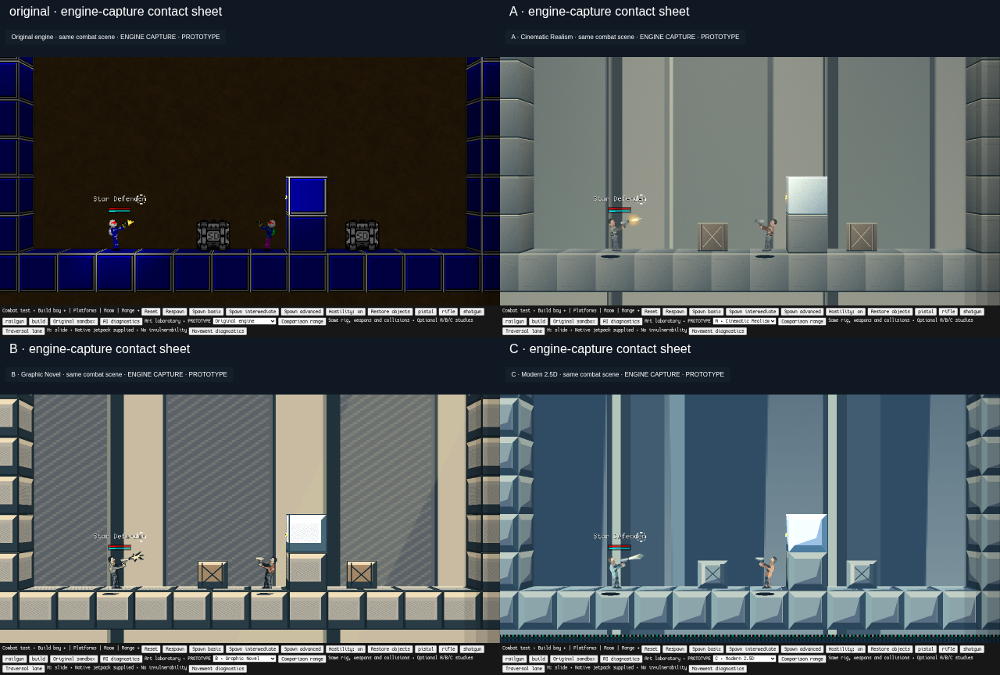
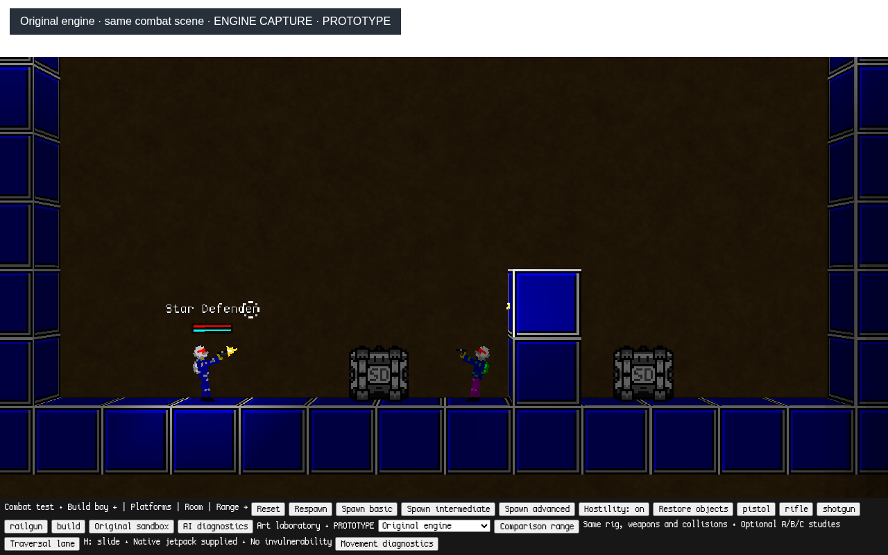
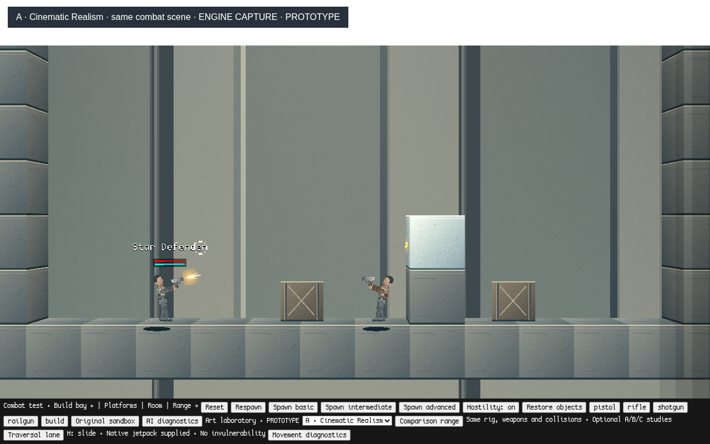
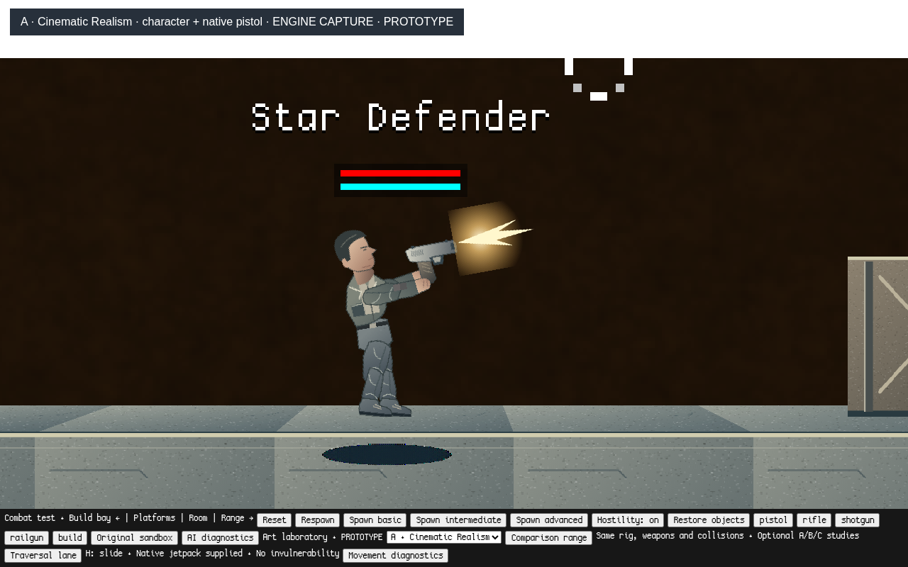
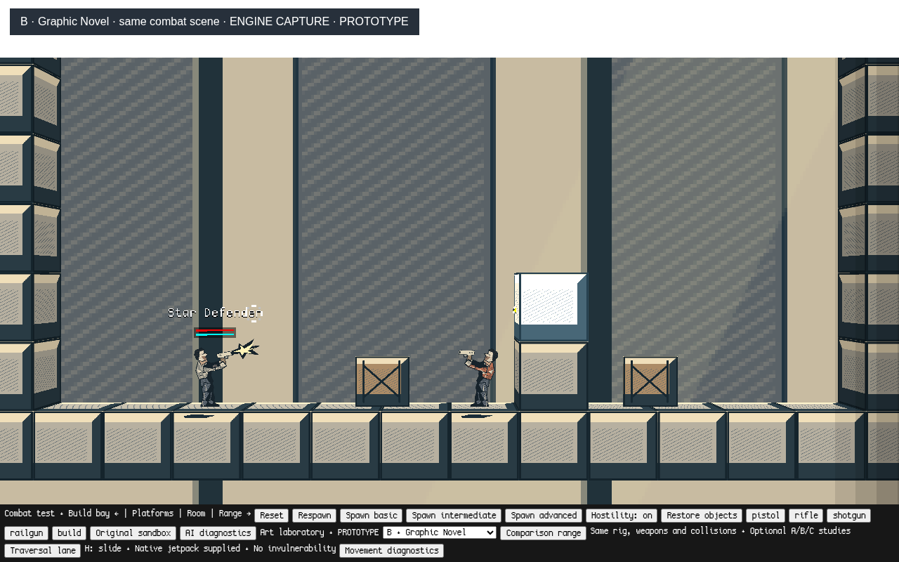
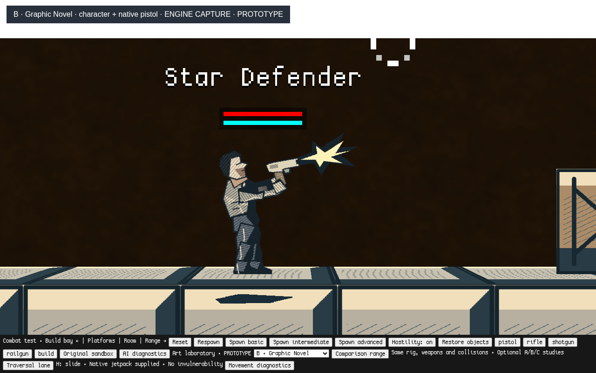
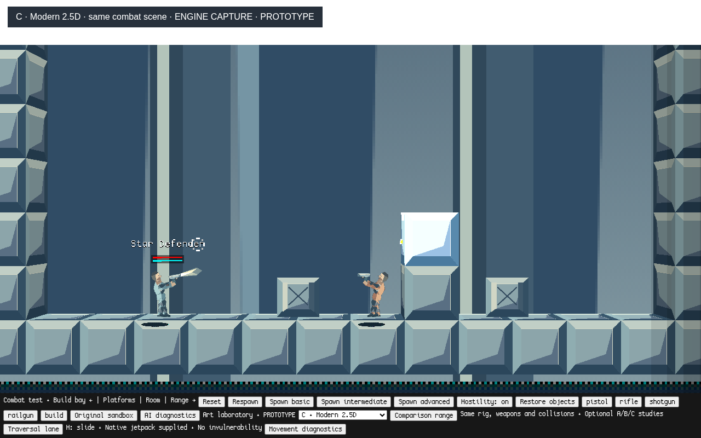
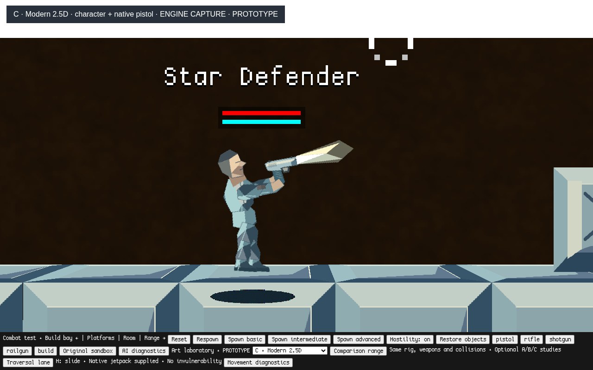
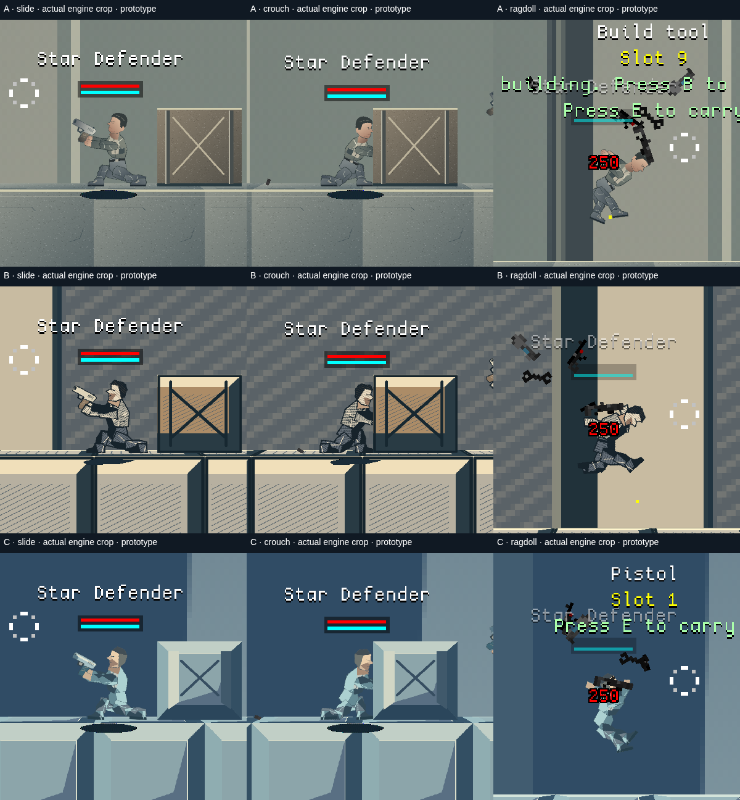

# Art direction laboratory — three playable studies

**Prototype artwork for creative evaluation. No final style or game identity is
selected.** A is a softer illustrative realism study, B is an inked graphic-novel
study, and C is a faceted/layered 2.5D study. A remains stylized because these
original code-authored assets retain the native rig's proportions. None is
presented as finished production artwork or an automated aesthetic success.

[Branch](https://github.com/jp8rtr59jt-coder/StarDefenders2D/tree/art-direction-lab)
· [macOS startup and controls](../../offline/ART_DIRECTION_LAB.md)
· [Technical comparison and recommendation](TECHNICAL_ASSESSMENT.md)
· [Raw validation and timing samples](validation.json)

## Same combat scene

The four panels below are a **contact sheet of actual engine captures**, assembled
without painted additions. Full captures follow. All use a 1280×800 viewport,
camera (736,100), scale 3.2, identical actor scale/positions, one existing pistol
type, one enemy, two native cargo props, fixed block geometry and the same shot
and wall impact. The new treatments use the same neutral architectural bays and
upper-left material light. Original uses the native presentation, including sky,
costumes and interface. B/C differ through contour/shadow/facet construction, not
merely color grading or higher source resolution.

## Original Star Defenders appearance

## A — Cinematic Realism exploration

Organic contours, a profiled face/hands, tapered clothing, folds/seams, natural
material values, subtle grain and softer muzzle light. This explores ingredients
for realism; it does **not** achieve realistic production anatomy or cinematic
lighting. More convincing anatomy, joint overlaps and human asset work remain.

## B — Graphic Novel exploration

Cut contours, large ink masses, clipped hatching, material separation and a sharp
burst shape. The value hierarchy offers a useful readability direction; hatch
density and joint intersections still need artistic editing at gameplay zoom.

## C — Modern 2.5D exploration

Authored faceted silhouettes, broad shaded planes, beveled surfaces, two background
depths with different parallax rates and a low foreground layer. These use the
existing WebGL/depth infrastructure and 2D physics. No new 3D character engine,
dynamic normal mapping or physically based lighting was added. Move the camera
in the playable lab to assess parallax; a still image cannot demonstrate it.

Close-ups use the same 12× magnification/camera relative to the player and are
character inspections, not normal gameplay or the performance benchmark. The
bounded backdrop can clip at extreme zoom and expose the native sky. Native
perspective can exaggerate foot/contact-shadow separation at that zoom.

## Sliding, crouching and ragdoll compatibility

These are **actual engine screenshot crops**, assembled into a contact sheet.
Columns show sliding, crouching and a native simulated death reaction; rows are
A, B and C. They are taken during separate live test sequences and are not
claimed to be the same animation frame across rows. The native HUD, dropped
weapons and damage text remain visible. These establish presentation coverage;
they do not replace human evaluation of motion, comfort or visual quality.

## Repeatable rendering measurements

Linux Chromium **156.0.8078.79**, ANGLE Vulkan **SwiftShader software rendering**.
The same frozen normal scene is used for every mode, with three warmup calls per
mode followed by 12 measured calls per mode in rotating order. All warm artwork
has already entered the caches. These timings exclude simulation and cold uploads.
Original here means native presentation inside the same loaded lab; the cached
experimental families remain resident. It is not a clean-launch memory baseline.

| Mode | CPU Render call median / mean | Render + `gl.finish()` median / mean | Draw calls |
| --- | ---: | ---: | ---: |
| Original | 0.70 / 1.46 ms | 0.75 / 1.49 ms | 3 |
| A | 0.50 / 0.94 ms | 0.50 / 0.94 ms | 3 |
| B | 0.50 / 0.86 ms | 0.50 / 0.86 ms | 3 |
| C | 1.60 / 4.26 ms | 2.65 / 4.48 ms | 4 |

CPU time around `Render` measures JavaScript/submission work and can omit deferred
GPU work. The completion interval includes CPU/driver work and a `gl.finish()`
wait, but excludes compositor/presentation timing; it is **not GPU-only time**.
The disjoint GPU timer extension was unavailable, so every GPU-only sample is
`null`. Actual GPU frame performance/FPS and input latency were not measured.
There is **no claim of improved performance**. Submission maxima were original: 4.6 ms, A: 4.9 ms, B: 2.6 ms, C: 31.4 ms. The small sample and software environment do not rank hardware performance reliably. C adds one batch in this scene. Test native Apple Silicon
and Intel macOS GPUs before setting production budgets.

The 75 cached canvases occupy about 18.23 MiB of raw RGBA source pixels, excluding
native assets, atlas storage, GPU copies and framebuffers. Source sampling and
memory are implementation costs, not proof of better art. See the raw samples
and the [architecture review](TECHNICAL_ASSESSMENT.md) for atlas/filtering limits.

## Validation scope and limits

The dedicated Chromium suite passed **19 checks**. It verifies optional startup
and separate storage; a native shot/impact; visible head and weapon framebuffer
pixels in all four presentations; identical positions, health, hitboxes, bone
positions/velocities and spring lengths across frozen style changes; live running,
sliding, crouching, firing/reloading, jumping/jetpack and simulated ragdolls in
A/B/C; repeated resets; save sentinels; and omission of the lab from existing modes.
No page exceptions or external requests were recorded. The known upstream
`audio/rocket_loop.wav` still returned 404; jetpack movement passed.

The [regression report](regression.json) records final passing runs of the
preserved movement suite (17 checks), combat suite (19), three AI tier fixtures
and native engagements, original sandbox (15, including save/reload), storage /
three encounter checks, and mode isolation. Prior milestone evidence is unchanged.
[Control validation](control-validation.json) covers a small inherited control
repair: enabling hostility now wakes live dormant test enemies with the existing
engine wake-up call. Three pre-fix combat attempts timed out; the same dormant
transition failed on the unchanged base export. Both failed evidence and passing
results are retained. AI policy, physics, weapon rules and regression assertions
are unchanged. Test-only health overrides in existing regression fixtures are
for observation; ordinary lab player/enemy health remains 250.

C's submitted layer positions were also measured during a 40-unit camera move:
far, near and foreground moved by 6, 18 and 48 world units relative to the camera.
This verifies the intended motion order; it is not a GPU frame-rate measurement.

The harness freezes both world updates and native render-time rig integration for
matched captures. It fires the native pistol and advances its real projectile
into an existing block before freezing the impact state. The playable code has
no clock/pose freeze. For the animation checks the harness makes the enemy passive
to isolate the player; ordinary lab enemies retain the existing AI and hostility
controls. Captures are engine output, not concept illustrations or target renders.

The environment is a bounded range patch. Other weapons, jetpack equipment,
dropped guns, skin/helmet customization, injury/gore art and the UI retain native
presentation. Custom parts do not yet have authored damage or animation variants.
No shared physics, AI or movement implementation was changed. macOS hardware,
subjective visual quality and production asset feasibility remain human evaluations.

## Recommendation for evaluation

Retain authored 2D parts on the existing rig/atlas and use controlled layered
depth. A's organic contour/material ideas, B's silhouette/value hierarchy and C's
spatial separation can be combined after creative evaluation. A final art style
is deliberately not selected. No campaign, setting, story, factions or large-scale
asset production follows from this milestone.

All new path artwork and adapters are original prototype work under GPL-3.0. No
external art, generated concept illustration, new font or runtime framework is
bundled. Existing contributor and third-party notices remain in the repository
and offline export.
