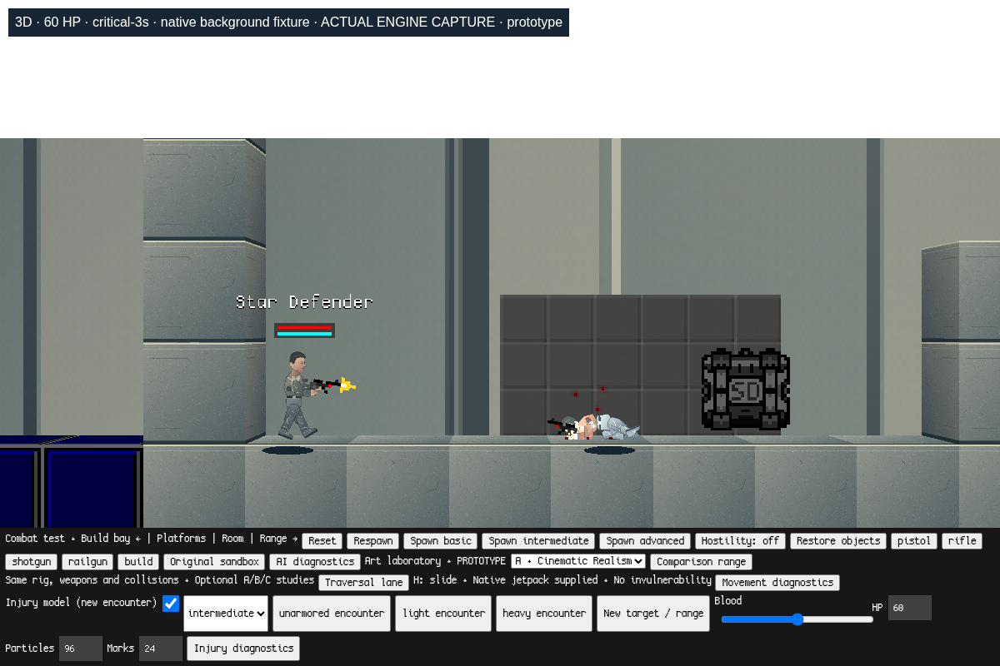
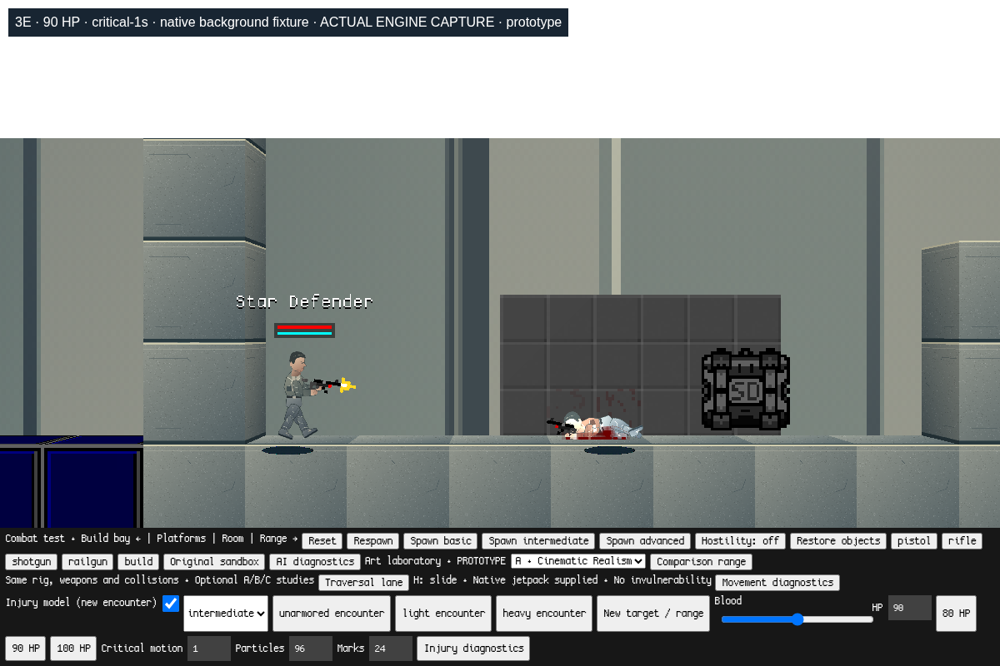
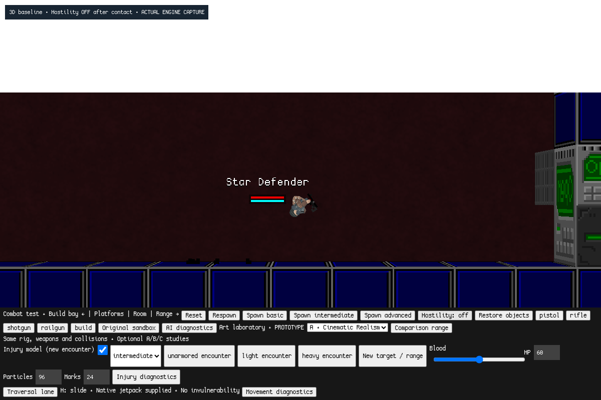
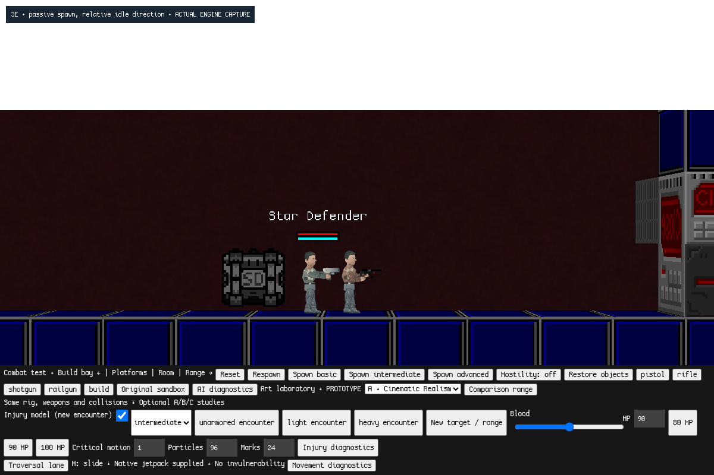

# Milestone 3E — combat feel refinement

Branch: `combat-feel-refinement`, based on `physical-combat`
`448aff64dc0aee5c824ed8d1f513106592a73996`.

This is another prototype for human playtesting, not final balance or a claim
of medical realism. Original modes, source branches and saved worlds are kept.
No weapon, map, artwork, renderer, rig constraint or dismemberment system is added.

## macOS startup

Requires Python 3 and Chrome/Chromium with WebGL. From this branch's checkout:

```sh
python3 offline/launch.py --no-browser
```

Open in Chrome and click **Start combat sandbox**:

```text
http://127.0.0.1:8000/?mode=combat&movement=1&art=1&physical=1
```

For a separate checkout:

```sh
git clone --branch combat-feel-refinement https://github.com/jp8rtr59jt-coder/StarDefenders2D.git StarDefenders2D-combat-feel
cd StarDefenders2D-combat-feel
python3 offline/launch.py --no-browser
```

The initial target is passive. Enable **Hostility** for an active encounter.
The new **80 HP / 90 HP / 100 HP** buttons reset the existing range for comparison.
HP remains independent of armor and training. Existing weapon buttons, R reload,
WASD, jump, native jetpack, H slide, construction and art selectors are retained.
**Critical motion** is 0 (off), 1 (provisional default) or 2 (stronger comparison).
Existing blood intensity and particle/mark cap controls remain.

The original sandbox is `/`; combat, movement and art modes retain their existing
URLs. Injury controls and presentation still require `mode=combat&physical=1`.
The same `sd-physical-combat-lab` disposable namespace is used, without a migration
or a write to old world namespaces. Stop the launcher with Control-C. No Node
game server, npm package or internet connection is needed to play.

## Durability and headshots

Biological health is provisionally **90**, identical across training tiers.
The previous 60 remains available through the existing numeric HP control.
Native gun damage, penetration categories, armor integrity and coverage are unchanged.

Measured native pistol shots, with spread controlled only in the fixture:

| Biological HP | Torso shots to kill | 3D bare-head shots at this HP | Refined bare-head shots |
| --- | ---: | ---: | ---: |
| 80 | 5 | 2 | 1 |
| 90 | 5 | 2 | 1 |
| 100 | 6 | 2 | 1 |

All three training tiers produced the same counts. Head vulnerability changes
from 2.6 to **3.4**, multiplying the existing native 1.65 head modifier: an
unprotected pistol head hit is **100.98** damage. This is independent of body HP
and remains configurable. Native approximate head detection is retained; it is
not a new anatomical hitbox system.

Armor still covers the torso in the prototype. Pistol HP loss remains **18 /
8.55 / 2.91** for unarmored/light/heavy torso protection; rifle loss remains
**20 / 20 / 14.41**. The railgun retains 85 body damage and bypasses the prototype
plates. Therefore a 90 HP torso can retain 5 HP after a rail hit; damage is not
silently increased to compensate for the new health. Evaluate this consequence
alongside the separately lethal headshots during playtesting.

Injury thresholds use a configurable **60 HP injury reference**, separating
injury response from biological durability. The established leg threshold stays
18 penetrating damage, arm interruption stays proportional to that reference,
and severe/accumulated thresholds stay 27/30 damage. Raising HP does not erase
the leg behavior that worked in 3D. Native instability calculations still run.

The provisional critical chance is **45%** for an eligible surviving severe
injury, up from 35%. Torso eligibility allows up to **55% remaining HP**. This
increases opportunities for meaningful critical injuries while a lethal shot
still causes native death immediately. Damage is never capped to force a long
death. In 128 fixed-seed native rifle leg encounters, 3D produced **49 critical /
79 recoverable** outcomes; refinement produced **60 / 68**. These are repeatable
fixture observations, not a guarantee about every live encounter.

## Critical presentation

The existing `_dying`, blood-loss damage, stability and articulated simulation
remain authoritative. Critical endpoints are still selected in **8–16 simulated
seconds**. Native bleeding contributes 3 HP/s; additional native `Damage` calls
now budget remaining health across the selected endpoint, with the prior minimum
extra rate retained. This avoids most of the sudden large health drop at the
deadline after raising biological HP. A hard native-damage endpoint still
terminates an artificially healed standard lab target. Further shots can kill sooner.

Occasional motion is a small velocity impulse on **one existing hand or ankle**,
then the unchanged native constraint/collision solver handles it. The first event
is scheduled 700–1400 ms after onset, subsequent attempts 1100–2400 ms apart.
There are at most **five** events; maximum velocity addition falls with the square
of remaining lifetime. Already-fast or distant bones are skipped. There is no
teleport, repeated pose clip, spring modification or continuing lab impulse
after death. Native death impulses and corpse settling remain intact.

Motion has its own per-actor seeded sequence, separate from injury decisions
and blood cosmetics. Distinct motion seeds produced different intervals and
limb choices. In the controlled 90 HP encounter, default event ceilings declined
from about **0.72 to 0.05 world units/tick**; all observed bone distances remained
under 20 world units from their owner. The intensity-2 stress case also remained
bounded. Intensity 0 produced no extra motion. These checks do not establish that
the motion looks convincing to a human viewer.

Critical blood emission adds a **320 ms** game-time cadence, follows an existing
rig bone, uses **1.35×** native droplets and a **1.7** severity factor. Native bleed
events continue through the same bounded emitter. Marks start at intensity 45
instead of 30. The existing **96 lab particle / 24 lab mark** caps and 80 ms
emission gate remain; no catch-up burst is emitted after a long time step.

A 3D bug prevented persistent marks: eagerly adding a new decal to the spatial
hash before its first native `onThink` made the merging pass find the decal
itself, then remove it. Creation now follows native `SendEffect`: index after
the first update. The native decal class and renderer are unchanged. In the
same supported-background fixture, the refined encounter emitted **216 native
droplets versus 60**, and left **two merged stains versus none**. Those totals
are emitted over the encounter, not simultaneously active particles.

Stains require actual native `sdBG` geometry. Procedural art backgrounds cannot
receive them, and this milestone does not add persistent floor stains. The
comparison uses temporary native 32-unit background tiles in the test harness;
they are not added as a new playable map. Native merge/fade rules still apply.

## Hostility diagnosis and correction

The baseline reproduces a newly spawned passive soldier retaining the constructor
look point **world (0,0)**. At its resting position, that is about **61° upward
from horizontal**, then the actor hibernates. Turning hostility off also retained
whatever look point the preceding combat left behind. The injury lab separately
relocated actors after initializing the policy's aim angle.

The baseline proximity trace **did not reproduce raw target tracking**: the look
point stayed (0,0) as the player approached. Native ragdoll drawing smooths look
coordinates and updates pose targets separately from an actor's sleeping physics;
the shared weapon transform reads the live attachment. Thus the reported visual
snap was not evidence of a new target being acquired in that trace. The fix
addresses stale/default coordinates and tests both raw state and weapon pose;
the unobserved part of the report is not claimed as conclusively reproduced.

The existing humanoid policy now has a small passive transition:

- New passive actors get a body-relative idle direction rather than (0,0).
- Hostility transitions clear native/policy targets, trigger/one-tap state,
  attack timers, forced fire and pending automatic shots.
- Both directions wake living actors. Passive aim settles toward a fixed facing
  at at most **180°/simulated second**, without reading player position or doing LOS.
- Once settled, native hibernation resumes. Proximity does not flip facing or aim.
- Re-enabling hostility resets perception and reaction timing, retaining the
  existing skill tiers, turn limits, aiming error and movement decisions.
- Critical/down actors do not receive an upright passive pose. Recovery restarts
  ordinary perception, and dead actors remain dead.

The range relocation resets the existing policy after assigning the final aim
and position. The muzzle coordinate solver, ragdoll smoothing and physics solver
are preserved. Tests cover sleeping actors, approaches from either side, a real
native upward acquisition, bounded settling, twelve repeated on/off cycles,
critical actors, dead actors and recovery. Previously fired projectiles continue
their native flight when hostility is disabled; no new shot is permitted.

## Engine captures

All frames below are actual engine captures with A and the existing rifle.
They use the same camera and temporary native background fixture. The baseline
uses 3D's 60 HP, refinement uses the provisional 90; the same seeded first leg hit
triggers the critical state. The camera/player pose are held while native target
simulation advances. These are comparable fixtures, not identical replay frames.

| At 1 simulated second | At 3 simulated seconds | At 6 simulated seconds |
| --- | --- | --- |
|  |  |  |
|  |  |  |

| Baseline passive aim | Refined passive aim |
| --- | --- |
|  |  |

## Validation and tuning

[Comparison and motion results](validation.json), [baseline measurements](baseline-feel.json),
[baseline hostility trace](baseline-hostility.json), [hostility regression](hostility-validation.json)
and [complete regression record](regression.json) contain the observed results.
`offline/combat-feel-test.cjs` and `offline/hostility-test.cjs` are repeatable
Chromium checks. The existing physical suite retains its coverage, reads configured
HP, verifies penetration damage independently of fatality, and now requires native
decals to survive their first update. Earlier milestone evidence is preserved.

Playwright and Node are developer test dependencies only. With the launcher up:

```sh
PLAYWRIGHT_MODULE="/path/to/node_modules/playwright" \
CHROMIUM_PATH="/Applications/Google Chrome.app/Contents/MacOS/Google Chrome" \
node offline/combat-feel-test.cjs
```

The primary controls are in `game/combat/physical.js`: `health`,
`headVulnerability`, `injuryReferenceHealth`, severe/remaining thresholds,
`criticalChance`, bleed endpoints/rate floor, critical blood cadence/scale,
droplet/mark intensity, caps, motion intensity/count/interval/speed.
Passive settling speed is `humanoidAI.passiveTurn`; active tier settings are unchanged.

The regression run also caught a retained native menu preview requesting the old
root grenade-launcher texture URL. The exporter now supplies the existing local
image there, like its existing build-tool alias. No gun definition or new weapon
is introduced. Missing optional `rocket_loop.wav` remains an upstream limitation.
Licenses and optional-music exclusion are unchanged.

Automation ran in Linux Chromium 156 with SwiftShader. Native macOS hardware,
subjective injury readability and combat feel still require human evaluation.
No performance improvement is claimed. Limb/head regions remain approximations
on the existing collider; blood marks require real backgrounds; five small
impulses may still be too subtle or too busy at some zoom levels. Evaluate body
HP, one-shot headshots, rail torso survival, critical frequency, motion and blood
density before further development. No creative setting or final identity is chosen.
