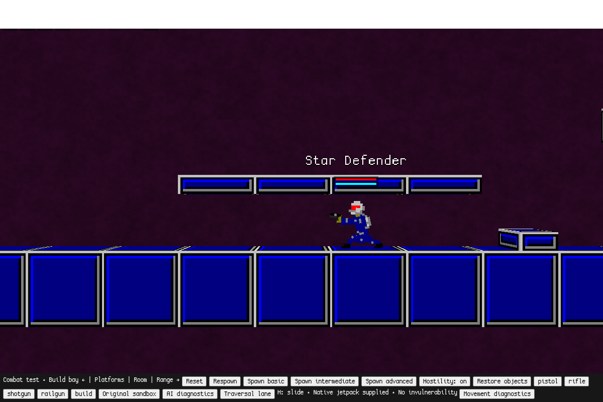
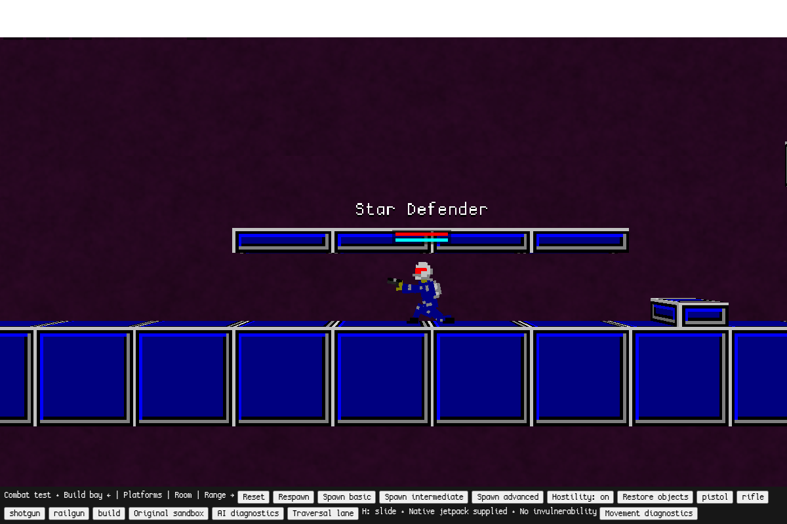

# 3G development checkpoints — movement and personal shields

Base: `d03c900219e14ea11ee55b2587e92194826d9766` (`playtest`).
Development branch: `integrated-combat-3g`. **Not ready for promotion.**

Recovery found one worktree, no new agent commits, a completed Astra architecture
report, a native crouch patch, a focused movement test, and unfinished integration
and CI drafts. Prior agents stopped at a usage limit. Continuation used one Sol
implementation agent; no further agents or duplicate architecture reviews ran.
No protection implementation or faction module existed to integrate at recovery.
Phase C1 now implements opt-in native NPC shields; see [C1 details and tests](c1/README.md).
The complete 3G milestone remains unfinished and is not promoted.

## Working change

Native walking acceleration previously halved only for crouch input. Clearance
could keep `_crouch_intens=1` after releasing S while acceleration returned to run
speed. The patch evaluates the penalty after native clearance/posture handling,
retaining it when standing is obstructed. Active sliding keeps its native
momentum/friction branch. No global speed cap or collider change was introduced.

16-tick actual-character Chromium samples:

| Posture | Before speed | After speed |
| --- | ---: | ---: |
| Standing | 6.074 | 6.074 |
| Holding S under ceiling | 3.059 | 3.037 |
| Released S under ceiling | 6.074 | 3.037 |

The shared fix also applies to native actors without the slide adapter.
Tiny differences in held-crouch acceleration reflect evaluating posture before
movement scaling; both held and constrained released crouch now match.

## Validation actually run

- Existing Python offline export: passed.
- `offline/crouch-test.cjs`: passed in Linux Chromium, including open/constrained
  crouch, clearance exit, slide input independence, wall interruption, jump,
  jetpack activation/release, rapid transitions and an unattached native actor.
- Existing **unmodified** `offline/movement-test.cjs`: passed, including firing,
  slide distance/friction, collisions, jetpack, death/ragdoll, repeated resets
  and original/combat/legacy save isolation.
- JavaScript syntax and Git whitespace checks passed.

[Focused results](crouch-validation.json), [baseline](crouch-before.json),
[existing movement suite](movement-regression.json), [architecture](architecture.md).

An initial test fixture sampled jump at one tick before native input processing
completed; the corrected fixture samples two ticks. Its failed measurement is
retained under recovered-drafts. The first server attempt was denied by execution
sandbox networking; tests ran after loopback-server access was granted.

Full combat/launcher regressions and native macOS tests were **not rerun** for
this partial checkpoint. No CI gate or complete 3G acceptance pass is claimed.

## Exact remaining work

1. Personal shield integration is implemented in C1; equipment UI/loadouts and
   broader faction acceptance remain for later phases. See its focused validation.
2. Add region-aware helmet integrity before biological head amplification and
   integrate existing native body armor/penetration with the physical policy.
3. Implement six independent faction/equipment/training loadouts, their minimal
   readable A overlays, native arsenal selection and limited matter preset/UI.
4. Adapt the recovered integration test to the actual implemented APIs; run
   native projectile damage-layer/balance and six-archetype acceptance checks.
5. Complete independent exact-commit quality gates and promotion scripts, run
   all mandatory regressions once, retain recovery ref and fast-forward only
   when the whole milestone passes. Verify remote SHA.

`recovered-drafts/` preserves the unfinished integration test and manifest.
The CI workflow draft is preserved locally in that directory but excluded from
this commit: automatic approval review rejected its upload, citing the earlier
human-approval policy despite the newer user authorization. It has not been
activated or executed. These drafts reference missing game APIs and missing gate scripts. The workflow
is stored as `.draft` outside `.github/workflows` so pushing this checkpoint does
not run broken automation or promote partial work. No draft is counted as tested.
`AGENTS.md` records the standing automatic-promotion authorization and safety gates.

## Testing this checkpoint

The installed Mac launcher continues to follow unchanged `playtest` (3F).
To inspect this development branch separately, use a separate checkout and the
existing `python3 offline/launch.py --no-browser`, then open
`http://127.0.0.1:8000/?mode=combat&movement=1`, click Start combat sandbox and
Traversal lane. Use S beneath the corridor ceiling and release S while moving.
Port 8000 is a separate browser origin; this does not migrate or clear 8001 saves.
Use Control-C to stop that development server. No launcher reinstall is needed
once a future complete 3G candidate actually passes promotion gates.
