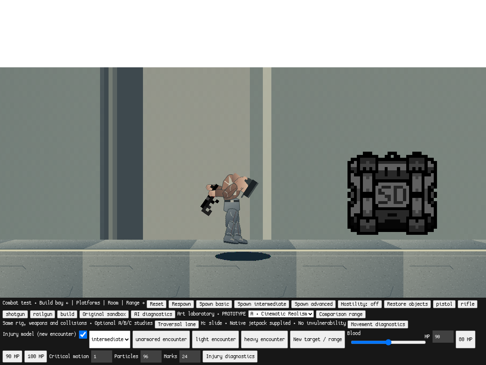

# Phase C2 — helmets and native body armor

Opt-in physical-combat NPC equipment only. Biological health remains 90 by
default. The C1 shield code and completed crouch fix are preserved; no factions,
weapons, maps, AI, CI or playtest promotion are included.

## Equipment API

In a separate development checkout, run the existing
`python3 offline/launch.py --no-browser`, open
`http://127.0.0.1:8000/?mode=combat&movement=1&art=1&physical=1`, then click Play.
Use Chrome's developer console to configure one target:

```js
const npc = sdPhysicalCombat.encounter('unarmored');
sdPhysicalCombat.equipArmor(npc, 'heavy', {
  resistance: .85, coverage: ['torso']
});
sdPhysicalCombat.equipHelmet(npc, {
  integrity: 60, absorb: .95, resistance: .85
});
npc.matter_max = npc.matter = 40;
sdPhysicalCombat.equipShield(npc, {
  capacity: 50, rechargePerSecond: 5,
  rechargeDelayMs: 1500, matterPerPoint: 2
});
```

Helmet defaults match the example. Integrity must be positive and finite;
absorption is 0–1, resistance is >0–1. State is available through
`sdPhysicalCombat.state(npc).helmet`; no biological HP is added. Re-equipping is
an explicit laboratory configuration action. No automatic helmet repair exists.

Body armor accepts native `light`, `medium`, `heavy` level-1 items, using their
original **130/190/250** durability, **30/40/50%** absorption and **0/5/10%** movement
penalties. It calls native `IsArmorBetter` / `ApplyArmor`, retains the native armor
snapshot/drop behavior and returns false if native replacement rules reject it.
For example, a legacy high-absorption experimental vest may reject a native
lower-absorption item; start an unarmored encounter for native comparisons.

Coverage defaults to torso; arms/legs can be explicitly added. Head coverage is
rejected because the helmet is independent. Resistance configures the existing
ammunition policy, while actual body capacity, absorption and speed penalties
remain native fields. Native depletion, overflow, breakage, penalty removal and
drops stay authoritative. New equipment does not change the old laboratory
armor presets. Encounter resets discard all disposable equipment policy state.

## Processing and feedback

Actual projectile hit location uses the engine's existing head multiplier and
physical region classification. C1 shields intercept first. Residual raw impact
energy reaches the helmet only on a native head hit; helmet absorption uses the
existing weapon penetration values. Only energy that passes the helmet receives
the existing native ×1.65 and physical ×3.4 biological head multipliers.

Effective equipment absorption is `absorb * clamp(1 - penetration/resistance)`.
Capacity limits the absorbed energy; excess continues to biology. A sufficiently
penetrating round can bypass a helmet without consuming its integrity. Uncovered
heads keep the established lethality. Body armor never additionally protects
helmeted heads; torso shots do not consume helmet integrity.

The native body health transaction occurs once. Injuries use actual biological
HP loss, with existing impulse/ragdoll code intact. Protected energy also feeds a
capped native stability response. Armor diagnostics now exclude armor dropped on
death: dropped capacity is not reported as absorbed damage on an uncovered hit.

Helmet hits reuse bounded native impact effects/sounds. Destruction adds three
native rock particles and an armor-break sound, subject to the existing effect
budget. A small code-drawn cap marker follows the original articulated head and
disappears at zero integrity. It is temporary equipment feedback, not final art
or a hitbox. Existing injury diagnostics show helmet integrity; history records
helmet absorption, integrity and breakage independently of native armor loss.

Internal bleeding still bypasses shields and armor; an intact/recharged shield
cannot extend the physical critical endpoint. Native bleeding may kill before
that deadline; the following normal tick updates the laboratory's dead phase.

## Observed validation

[Focused actual-projectile results](helmet-validation.json) and
[relevant regression record](regressions.json) contain measured results.
The tests use native `sdGun.Shoot`, projectile sweeps and character damage.
Synthetic interior wave cases carry pistol penetration metadata explicitly.

Representative 90-HP target results (test helmet: absorb 1, resistance 1):

| Native pistol head hit | Helmet absorbed | Biological loss |
| --- | ---: | ---: |
| Exposed | 0 | 100.98 raw; lethal |
| 60 integrity helmet | 16.2 | 10.098 |
| 5 integrity helmet | 5, then breaks | 72.93 |
| 5 shield + 60 helmet | shield 5, helmet 11.7 | 7.293 |

A native rifle penetrates more helmet protection than a pistol; the native
railgun fully bypasses this test helmet. Native body armor retains its original
capacity and movement penalty, and breaking a 4-point remaining vest restores
normal movement penalties and passes the proper residual damage to health.

Linux Chromium/SwiftShader checks cover damage, C1 interactions, helmet failure,
native armor, uncovered regions, protected stability, bleedout/ragdolls, invalid
configuration and repeated resets. Native macOS Finder/GPU behavior is not
claimed. The pre-existing optional `rocket_loop.wav` remains unavailable.

## Limits and remaining milestone work

Helmet coverage uses the native coarse head region, not pixel-accurate anatomy
or face openings. Arms retain the existing approximate rig-overlap classification.
Equipment is a disposable laboratory policy, not a new saved inventory format.
Unlocalized direct damage keeps native body-armor/C1 shield semantics; it is not
assigned invented helmet hit coordinates. Legacy non-finite shields retain their
original behavior. Values and marker artwork remain playtesting prototypes.

Faction archetypes, equipment UI/loadouts, broader balance comparisons and the
full-milestone independent promotion gates remain future 3G work. The installed
Mac launcher still follows unchanged `playtest`; no reinstall is needed.

Observed final run: **16 focused C2 checks passed**, plus the unchanged C1 shield
suite (**17 checks**), physical-combat suite and crouch regression. Offline export,
JavaScript syntax, whitespace and exported-source equality checks passed.
No unexpected JavaScript exceptions or external browser requests were observed.

Actual engine marker comparison, same framed fixture; the second capture sets
helmet integrity to zero directly to isolate the draw state (not another shot):



