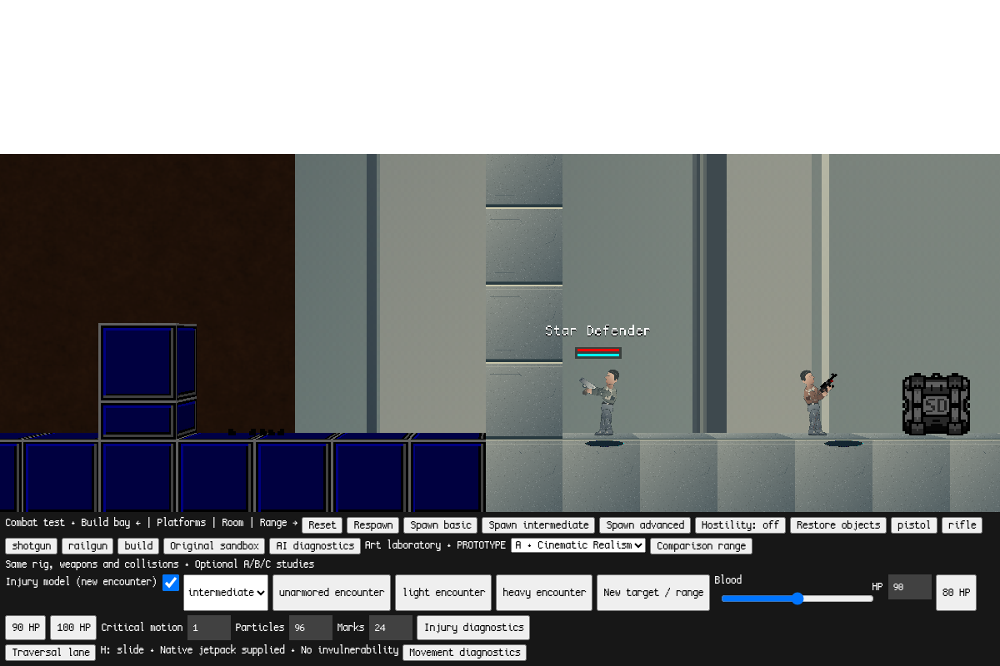

# Milestone 3F — one-click macOS playtests

The initial `playtest` branch contains approved Milestone 3E
`269c784c6ca22e7bf33e51475b8bcd8d38acd1c1` plus this launcher infrastructure.
No gameplay, AI, weapons, armor, art, movement, injury or balance files change.
`playtest` is the only branch the permanent launcher follows. Future feature
branches are **not** installed until you explicitly approve their promotion.

## Install once

Prerequisites: **Git, Python 3.9+ and Google Chrome**. No Homebrew, Node, Electron,
game server package, administrator command or background service is required.
If `git --version` asks for Apple Command Line Tools, complete Apple's setup
(`xcode-select --install` opens that installer). Python is available from
[python.org](https://www.python.org/downloads/macos/). Chrome must be registered
as **Google Chrome**, normally in Applications. Prerequisites are checked, not
silently installed. A managed Mac may need its administrator/IT to supply them.

For the recommended one-time setup, paste this into Terminal **once**:

```sh
curl --fail --location --proto '=https' --tlsv1.2 \
  'https://raw.githubusercontent.com/jp8rtr59jt-coder/StarDefenders2D/playtest/Install%20StarDefenders.command' \
  -o "$HOME/Downloads/Install StarDefenders.command" && \
bash "$HOME/Downloads/Install StarDefenders.command"
```

This downloads the installer from this fork's approved branch. Its readable
[source](../../Install%20StarDefenders.command) clones only this repository's
`playtest` branch into:

```text
~/Games/StarDefenders2D
```

It stages the clone first, refuses an unrelated/existing non-playtest folder,
and sets the permanent launcher's executable bit. Existing files are not
replaced. If that destination is an old ZIP folder, rename the old folder first
or choose another destination with the installer's `--destination` option.
An already valid playtest installation is reused without replacing local files.

Alternative, if you prefer to clone directly:

```sh
mkdir -p "$HOME/Games"
git clone --depth 1 --single-branch --branch playtest \
  https://github.com/jp8rtr59jt-coder/StarDefenders2D.git \
  "$HOME/Games/StarDefenders2D" && \
open "$HOME/Games/StarDefenders2D/Play StarDefenders.command"
```

You can also save the installer as a `.command` file from GitHub. A browser may
give a downloaded script a `.txt` extension or remove executable permission;
keep the `.command` suffix. To run that downloaded file directly in Finder,
use `chmod +x "$HOME/Downloads/Install StarDefenders.command"` once. The
`curl`/`bash` method above does not require that installer permission step.

## Every subsequent play session

Double-click **Play StarDefenders.command** in `~/Games/StarDefenders2D`.
Make a Finder alias on your Desktop/Dock if useful; the launcher resolves
symlinks and does not depend on Terminal's working directory. A plain copied
launcher also finds the standard `~/Games/StarDefenders2D` installation. For a
custom installation path, use an alias to the actual launcher.

The launcher:

1. Checks Python/Git, verifies the intended checkout and obtains a single-instance lock.
2. Reserves **127.0.0.1:8001** before any update/build.
3. Fetches **only** the intended repository's `playtest` ref and fast-forwards
   a clean playtest checkout. It never switches branches, resets, stashes or forces.
4. Builds changed versions using the existing Python exporter in a separate
   staging folder. An unchanged complete version is reused.
5. Starts the existing loopback-only HTTP launcher, using the exact reserved socket.
6. Verifies the served repository/branch/commit before invoking macOS's
   `/usr/bin/open -a "Google Chrome"` with the game URL.
7. Uses the existing ready button to start the native offline laboratory after
   its modules, settings and browser storage are ready. No manual Play click is needed.

The address is always:

```text
http://127.0.0.1:8001/?mode=combat&movement=1&art=1&physical=1
```

That includes intelligent combat, sliding/jetpack, A artwork and native crates,
physical injuries/armor and 3E's 90 HP tuning. All existing controls and art
selectors remain. The original menu is still at `http://127.0.0.1:8001/` and is
not automatically started.

**Keep the Terminal window open while playing.** It prints the installed commit,
update result, actual running commit and address. Use **Control-C** there to stop
the server cleanly. Closing that Terminal also stops its supervised server;
there is no launch agent/daemon to uninstall or lingering background server.
Closing Chrome alone leaves the visible Terminal/server running. In an original
saved world, use the engine's Save & quit before ending a session.

If macOS blocks a downloaded/unsigned `.command`, follow its normal **Open** or
**Privacy & Security → Open Anyway** prompt after attempting to open the file.
Exact prompts differ by macOS version and device policy. No Gatekeeper setting
is disabled and quarantine attributes are not stripped. Cloning with Git normally
retains the tracked executable permission; the installer also applies `chmod +x`.

## Updates, failures and saves

The update URL and branch are fixed in `offline/playtest.py`; a changed origin,
local URL rewrite, wrong branch, local commits or uncommitted/untracked files
prevent automatic source replacement. Git credential prompts, local hooks and
submodule fetching are disabled. Only approved GitHub source is downloaded; no
other installer is run during launch. New exporter/server code comes from that
approved source. Launcher logic itself is picked up on subsequent launches;
the current launch builds/serves the newly approved game files immediately.

GitHub being offline does not remove the installed version. A clean, previously
approved checkout can be built without a successful network check; an existing
complete export can run even if Git is temporarily missing. **Python is always
needed** to serve the game. All failures are printed clearly. A Terminal error
waits for Return rather than immediately disappearing.

Exports are kept under ignored `.playtest/exports/<commit>/`, with an atomic
completion/version marker and current pointer. The current and one previous
complete export are retained; older owned generated exports are removed. A failed
or partial new build never replaces the working export. Each complete export
includes its own known-working server copy, so fallback does not depend on a
newly broken exporter/server in the updated source checkout. If source updates
or builds are skipped, the **actual old running commit is printed explicitly**.
If no safe complete export exists, launch fails with instructions and preserves
the installation. Local edits are never automatically repaired or deleted.

Port conflicts are refused. No unrelated process is killed, no occupied server
is reused/probed by the launcher, and the browser is not opened. Stop the previous
game Terminal with Control-C, or close the other service yourself, then retry.
The launcher never silently switches to a new port. A second click on an already
running installation explains that its existing Terminal must be stopped first.

Assets/modules are served with `Cache-Control: no-store` and conditional stale
responses are disabled for this launch path. Browser IndexedDB/localStorage are
not cleared. The fixed hostname/port preserve existing 8001 saves and the existing
`sd-physical-combat-lab` namespace. An old `localhost` or port-8000 save is a
different browser origin; this launcher deliberately does not migrate or delete it.
Use the same Chrome profile as your earlier port-8001 playtests to access those saves.
After an update, use the newly opened tab or reload an older already-running tab.

For a read-only version report, optionally run once in Terminal:

```sh
python3 "$HOME/Games/StarDefenders2D/offline/playtest.py" --status
```

Normal double-click launches report whether GitHub is up to date. `--status`
does not fetch, change files, start a server or open Chrome. `--no-browser` is a
developer/manual-browser option; it still uses exactly port 8001.

## Future Codex promotion workflow

1. Start development on an isolated feature branch **based on current playtest**
   so it includes the permanent launcher and remains eligible for fast-forward promotion.
2. Finish and record automated regressions; provide the feature for human evaluation.
3. Wait for the user's explicit approval to promote that milestone to `playtest`.
   A feature commit/push alone is **not** approval.
4. Sync and fast-forward `playtest` to the approved feature commit, then push that
   branch to `jp8rtr59jt-coder/StarDefenders2D`. Verify its remote commit hash.
   Use the fork remote, which need not be named `origin` in a developer checkout.
5. The next permanent-launcher click fetches that approved ref, builds it safely
   and opens Chrome. No new ZIP or launcher installation is needed.

Do not force/reset `playtest` or promote a diverged branch automatically. If a
feature started from an older base, integrate its changes on a branch based on
current playtest, rerun checks and obtain approval for the concrete result.
Retain the launcher scripts, `.playtest/` ignore rule and serving protocol during
future promotions. The initial creation of this branch is authorized by Milestone
3F; it does not authorize automatic future promotions.

There is no `.github/workflows` directory in the approved 3E base and no Pages
workflow was found there. No workflow, repository visibility or hosting setting
is created, changed or removed. Repository-level Pages configuration was not
queried through the connected API; this milestone does not rely on it. GitHub
only distributes approved source. The game is hosted on the Mac's loopback interface.

## Validation and limits

[Fault/workflow results](validation.json), [actual-game browser results](browser-validation.json)
and [regression record](regression.json) record observed results. Developer tests:

```sh
python3 offline/launcher_test.py
PLAYWRIGHT_MODULE=/path/to/node_modules/playwright \
CHROMIUM_PATH=/path/to/chromium node offline/launcher-browser-test.cjs
```

Git fault tests use real private local repositories while a test-only executable
maps the production launcher's fixed GitHub URL to those fixtures. Production has
no arbitrary repository override. The actual-game test installs the full real
source through the production installer/exporter, verifies automatic native lab
startup and a private test promotion, then checks same-origin saved data, version
and asset headers. Those private fixture commits are never pushed to GitHub.

The managed environment already uses port 8001 for its browser gateway. It was
left untouched. Linux network namespaces provided an isolated **127.0.0.1:8001**
for the exact-port integration tests, rather than changing the production port.
Chrome launching via macOS Launch Services is mocked separately; actual engine
rendering is tested in Linux Chromium/SwiftShader. A PTY checks the error pause.



Native Finder double-click behavior, Gatekeeper prompts, Apple Command Line Tools
installation and native macOS Chrome opening have **not** been tested on a Mac.
The Bash scripts use macOS-compatible system tools and retain executable modes.
macOS/IT permissions may still require a normal one-time approval. Existing
optional `rocket_loop.wav` is still missing upstream; optional music remains
excluded and required license notices remain in each export. No gameplay or
macOS GPU-performance improvement is claimed. Stop here for launcher playtesting;
this milestone does not begin another gameplay feature.

Regression testing also exposed missing URL aliases for the existing stock sword
preview sprites. The exporter supplies them from the original local artwork;
no weapon, artwork or game simulation source was changed.
