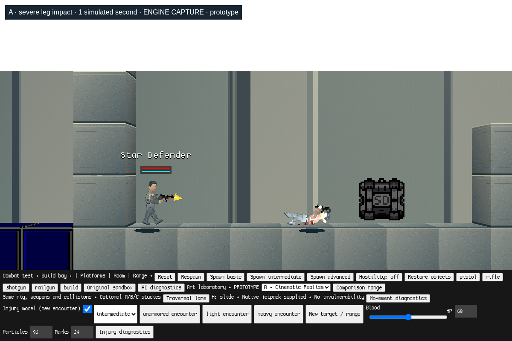
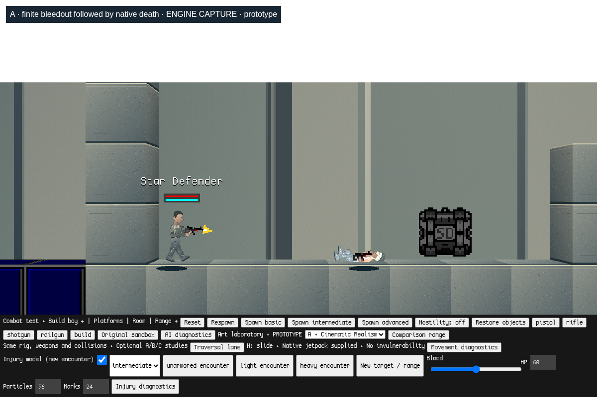

# Milestone 3D — physical combat laboratory

Historical 3D assessment and measurements. On `combat-feel-refinement`, see the
[3E update](../combat-feel-refinement/README.md) for current defaults and fixes.

Optional, reversible combat experiment based on `art-direction-lab`
`6e63988d7577901beabed666cf2079a625b92b63`. Source branches and main are preserved.
Cinematic Realism A remains the preferred artistic foundation; this milestone
adds no production artwork, setting, story or new weapon.

Stage 1 is a separate commit:
`5458bed099ae6532ce43972d17b4d6b9602edeaa`.
Its [technical explanation, four-style screenshots and checkpoint results](STAGE1.md)
cover the shared weapon coordinates, swept cover checks, native rail-beam origin
and restored **original crates in A**. Stage 2 builds on that checkpoint.

## Test on macOS

Requires Python 3 and Chrome/Chromium with WebGL. From a checkout of
`physical-combat`, run:

```sh
python3 offline/launch.py --no-browser
```

For a separate fresh checkout, without touching an existing folder:

```sh
git clone --branch physical-combat https://github.com/jp8rtr59jt-coder/StarDefenders2D.git StarDefenders2D-physical-combat
cd StarDefenders2D-physical-combat
python3 offline/launch.py --no-browser
```

Open this exact address in Chrome and click **Start combat sandbox**:

```text
http://127.0.0.1:8000/?mode=combat&movement=1&art=1&physical=1
```

The launcher builds and serves local files. No Node game server, npm installation
or internet connection is required; optional music remains excluded. Control-C
stops the launcher. The root menu also has a **Physical combat laboratory** link.
Retain the same hostname and port for browser saves.

1. The initial target is passive. Select **unarmored**, **light** or **heavy
   encounter** for a fresh, repeatable target and player at the existing range.
2. Select a training tier independently; all lab tiers have the same biological
   health and use an existing rifle. Existing standard enemy buttons retain
   their original 250 HP, loadouts and improved AI.
3. Use the existing pistol/rifle/shotgun/railgun buttons. Aim with the mouse;
   left click fires, R reloads. Existing movement, crouch and jetpack controls
   remain; H slides in the optional movement prototype.
4. Turn **Hostility** on for an active fight. It stays under the existing native
   AI architecture and competence policy. Turn it off for stationary shot tests.
5. **Injury diagnostics** shows location, penetrating loss, absorbed damage,
   health, armor, down/critical state, endpoint and native weapon stun.
   AI and movement diagnostics remain available separately.
6. **HP** changes target health (20–200) and starts a fresh encounter. It never
   changes player health. Blood intensity is 0–2; particle/mark caps are editable
   and immediately trim existing laboratory effects when reduced.
7. Uncheck **Injury model** for a fresh **native 250 HP damage comparison**;
   recheck it to restore the configured injury model. Armor then uses its native
   all-body handling rather than experimental location/penetration rules.
8. Existing Reset, Respawn, art selector, Comparison range, Traversal lane and
   building controls remain. Comparison range creates its original art-scene
   enemy; an injury encounter button returns to the laboratory targets.

Existing modes remain accessible at `/`, `?mode=combat`,
`?mode=combat&movement=1`, and `?mode=combat&movement=1&art=1`.
The injury module loads only with `mode=combat&physical=1`; art and movement flags
are optional. Its disposable storage namespace is **sd-physical-combat-lab**,
separate from original, combat, movement, art and legacy saves. No old world is
loaded or migrated into this arena.

## Reused combat systems

`sdBullet.onMovementInRange` still performs native hit filtering and collision.
For explicitly attached lab targets only, a small optional configuration policy
supplies per-hit armor absorption and injury reactions. Native
`DamageWithEffect` / `sdCharacter.Damage` remain responsible for damage text,
health subtraction, armor accounting/break sounds, stability, death and drops.
Projectile impulse, recoil, spread, velocity, shotgun pellets, rail behavior,
critical ranges and weapon definitions are preserved.

Native stability releases the existing articulated ragdoll from its upright
pose. Native `_dying` already causes blood loss and intermittent damage effects;
the laboratory reuses it instead of introducing another ragdoll or medical
simulation. Native `weapon_stun_timer` prevents shooting while down or suffering
the short arm response. The original AI is paused while incapacitated and
reacquires through its existing policy after a temporary knockdown. NPC base
mobility remains the native 33; a temporary leg penalty scales that value.
The player is never attached to the injury policy. Localized responses originate
from projectile contacts; fall, crush and other environmental damage retain
their native behavior rather than acquiring a new anatomical model.

The additions are in [game/combat/physical.js](../../game/combat/physical.js).
Character hooks do one optional policy lookup; they do not change the movement
solver, hitboxes, ragdoll constraints or original damage path. No extra entity
search or line-of-sight pass is added per frame. State is stored in a WeakMap;
target records, recent hit history and effect lists are bounded. Reset removes
the lab's effects and records before creating fresh actors.

## Location and injury rules

These are gameplay approximations, not anatomical or medical claims:

| Region | Detection | Prototype response |
| --- | --- | --- |
| Head | Existing native head multiplier test | 2.6 × existing 1.65 head multiplier; unprotected pistol hit is 77.22 damage |
| Torso | Remaining central body contacts | Native flinch; accumulated/severe loss can knock down or become critical |
| Arms | A native arm rig segment close to a contact on the existing body's edge | 500 ms native weapon stun and transient recoil after a significant hit |
| Legs | Lower 28% of the existing body box | 55% of native mobility for 2.2 seconds; significant impacts can knock down |

No independent limb colliders were added. Extended arms/hands outside the body
box cannot receive separate projectile hits. The head test remains the engine's
existing height approximation, including while crouching or down. This is not
pixel-perfect damage against the rendered silhouette. Native dead/crouched
hitboxes still change through their existing simulation rules.

An ordinary first torso hit does not force collapse. A hit losing 45% of maximum
health, accumulated loss of at least 50%, or a leg hit losing at least 30% is
severe. It produces a configurable temporary knockdown. A surviving severe
head/leg hit, or a severe hit leaving at most 45% health, has a **35%** prototype
chance of entering critical `_dying`. Fatal hits remain fatal: no damage is
capped to force an incapacitation, and there is no invulnerability window.

Critical actors cannot shoot, jetpack or make AI movement decisions. The existing
physics and residual impulses move and settle them; no recurring twitch force
or forced pose is added. Native bleeding loses **3 HP/second**. A small seeded
extra loss is added, with an **8–16 second maximum endpoint** selected at onset.
Death can occur sooner through blood loss or further hits. The endpoint uses
native `Damage`, bypassing armor, and guarantees termination for these standard
lab actors even if their health is artificially raised during a test. After
death, native corpse/ragdoll handling takes over. There is no new healing or
rescue system; noncritical lab injuries delay native regeneration for 10 minutes.

All injury timers advance with `GSPEED / 30`, not browser wall-clock time.
Critical decisions use a per-actor seeded sequence; cosmetic blood has a separate
sequence so changing intensity does not consume that actor's injury sequence. The wider native
simulation and entity-ID allocation are not a deterministic replay system.

## Armor and ammunition configuration

All three training tiers default to **60 biological HP**. Armor has independent
native integrity; the prototype profiles cover **torso only**, with no invented
helmet artwork. `armorProfiles.coverage` can be changed for later equipment tests.

| Profile | Integrity | Base absorption | Resistance |
| --- | ---: | ---: | ---: |
| Unarmored | 0 | 0 | 0 |
| Light | 60 | .70 | .40 |
| Heavy | 100 | .95 | .85 |

Prototype penetration categories: pistol **.10**, rifle **.60**, shotgun **.08**,
railgun **1.00**, other projectiles **.25**. Each native penetration level above
the normal gun level of 3 adds .04, capped at 1. These are tunable ammunition
categories, not real-world caliber or material claims. Native block penetration
properties are untouched.

For a protected region:

```text
effective absorption = base absorption × clamp(1 − penetration / resistance, 0, 1)
```

Native armor subtracts the absorbed portion from its integrity; the rest reaches
health. Native overflow/break handling exposes health when integrity runs out.
High penetration can bypass an intact plate rather than magically destroying
it. Uncovered regions bypass the armor pool. Armor absorption produces existing
wall-hit feedback and the local `world_hit2` sound; native break feedback remains.

Observed native shot outcomes at ordinary range:

| Projectile | Unarmored HP loss | Light torso armor HP loss | Heavy torso armor HP loss |
| --- | ---: | ---: | ---: |
| Pistol, 18 base damage | 18 | 8.55 | 2.91 |
| Rifle, 20 base damage | 20 | 20 | 14.41 |
| Railgun, 85 base damage | Fatal | Fatal, bypasses plate | Fatal, bypasses plate |

A depleted heavy plate with 4 integrity absorbed 4 from an 18-damage pistol hit,
broke natively and passed 14 damage to health. In a controlled torso fixture,
all tiers died after four pistol hits instead of the original 14. Head shots,
native shotgun range bonuses and simultaneous pellets can kill sooner.

## Blood and effect limits

The policy emits existing native red/green blood droplets with a small
projectile-directed component and native gravity/collision. Significant wounds
emit more; `_dying` emits intermittently through the existing bleed timer.
Default limits are **96 lab particles** and **24 lab marks**, intensity **1**,
with an 80 ms per-actor emission gate and a 400 ms mark gate. Native effect
quality also imposes its own particle budget.

Marks use native `sdBloodDecal` and require actual `sdBG` geometry at the wound.
They use native merge/removal rules; on some constructed backgrounds they persist
until reset, still under the mark cap. The art background is a draw layer, not
`sdBG`; it cannot receive persistent decals. Droplets can hit the existing floor
but do not create new floor stains. The decal test adds a real, noncolliding
native background fixture; no invisible colliders or new renderer are used.
Native generic impacts, gib effects and unrelated actors retain their original
effect handling; the laboratory caps its own emissions rather than replacing
the engine's global effect budget.

## Captured reaction sequence

Actual WebGL engine captures using A, the existing rifle and native rig. These
are controlled fixed-step fixtures: the target advances while the camera and
player pose are held for comparison. They are not concept art, medical evidence
or proof of subjective animation quality.

| Collapse, 1 simulated second | Incapacitated, 3 simulated seconds |
| --- | --- |
|  |  |



## Validation and limitations

[Stage 2 raw integration results](stage2/validation.json) and
[full regression record](stage2/regression.json) contain observed outcomes.
The integration fixture fires actual `sdGun.Shoot` bullets and advances their
native collision code; it does not call a replacement damage solver. Controlled
randomness removes weapon spread only in the fixtures. Death, instability,
armor break and blood loss use native character methods.
The active-AI observation temporarily raises the test player's health to 1000
so a useful observation window survives; encounter reset restores 250. This is
a test fixture, not a playable health or damage change.

To reproduce the new automated integration check, keep the launcher running
and use Node with an independently installed Playwright package (test tools
are not game dependencies):

```sh
PLAYWRIGHT_MODULE="/path/to/node_modules/playwright" \
CHROMIUM_PATH="/Applications/Google Chrome.app/Contents/MacOS/Google Chrome" \
node offline/physical-test.cjs
```

The existing `offline/*test.cjs` suites are retained. The regression record lists
each run; older suites were run from a temporary working directory so their
previously committed screenshots/results were not overwritten.

A seeded rifle leg hit left 40 HP, collapsed the actor, produced no enemy bullets
while AI was enabled, and reached native death at about **10.97 simulated
seconds**. The rig stayed finite through the corpse check. A separate endpoint
fixture artificially raised the critical actor to 1000 HP and still terminated.
A 32-encounter sample produced both recoverable and critical outcomes; see the
raw record for counts. Six fresh live encounters returned the same bounded
entity count and cleared all lab state. Native saves in four prior namespaces
and legacy localStorage retained their sentinels.

Chromium 156 automation runs on Linux with SwiftShader. It does **not** validate
macOS GPU performance, medical realism, subjective combat feel or every possible
ragdoll/geometry arrangement. Native `rocket_loop.wav` remains an existing
missing optional audio asset (404). No new external network dependency or
framework is introduced. All existing license/attribution files are retained;
no new third-party artwork or optional music is distributed.

## Dismemberment investigation — not implemented

`sdCharacterRagdoll` owns its bones, draw springs and angular restrictors.
`sdBone` collision is for articulated environment response; bones are invisible,
not independently targetable damage entities. `Delete()` removes the whole
owned rig. Arms also have extra chest/hand distance constraints; simply removing
one visible spring would leave other constraints pulling the limb back.

The smallest credible later prototype would identify one limb subtree, disable
every constraint crossing its boundary, transfer that bounded component to a
separate owner/lifetime, and render its existing parts with the same pivots.
It would need correct collision/owner filtering, reset/death cleanup and artwork
for attachment caps. Localized damage routing also needs a deliberate decision
because native bullets currently hit the character box, not each bone. This is
more than a safe single-flag change. No constraints, bones, render contracts or
limb separation are modified in this milestone.

## Human decisions and later playtesting

Tune `tuning`, `armorProfiles` and `ammunition` in `game/combat/physical.js`.
Priorities are biological health, head vulnerability, torso coverage, absorption
versus penetration, severe-hit thresholds, critical chance, knockdown/recovery,
bleed endpoint/rate and blood density/caps. Evaluate these against moving
opponents with each training tier; automated counts do not establish good feel.

Creative approval is still needed for final lethality, readable armor equipment,
duration/frequency of incapacitation, violence intensity, floor-mark artwork,
possible limb separation, and future A/C visual production. Setting, narrative
and final identity remain undecided. This branch stops at the prototype for
human playtesting and creative evaluation.
