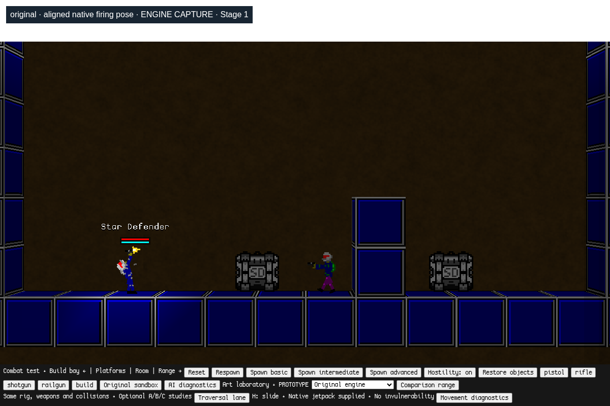
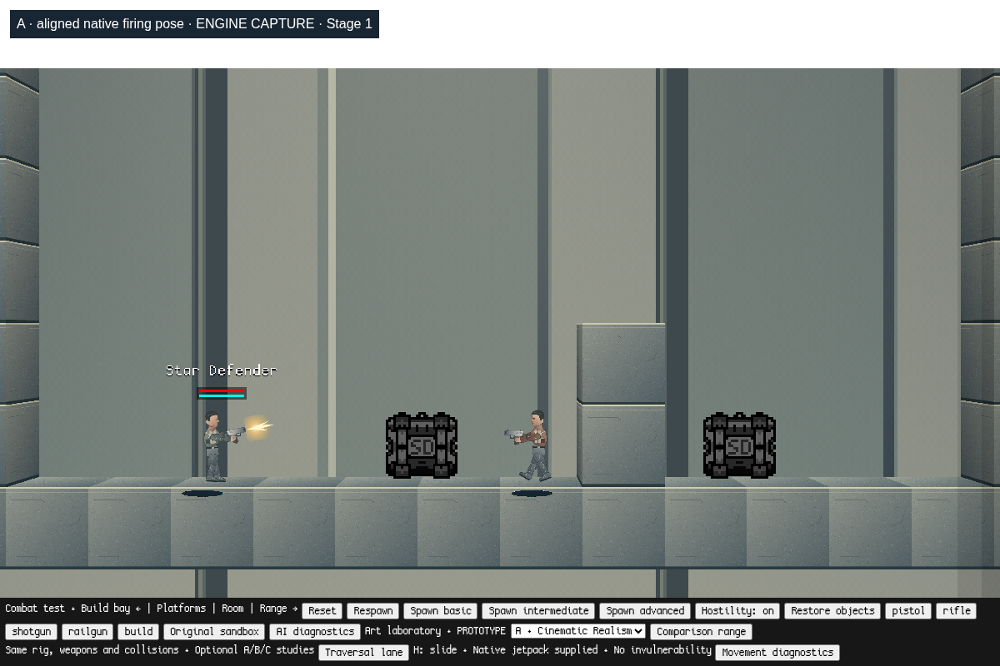
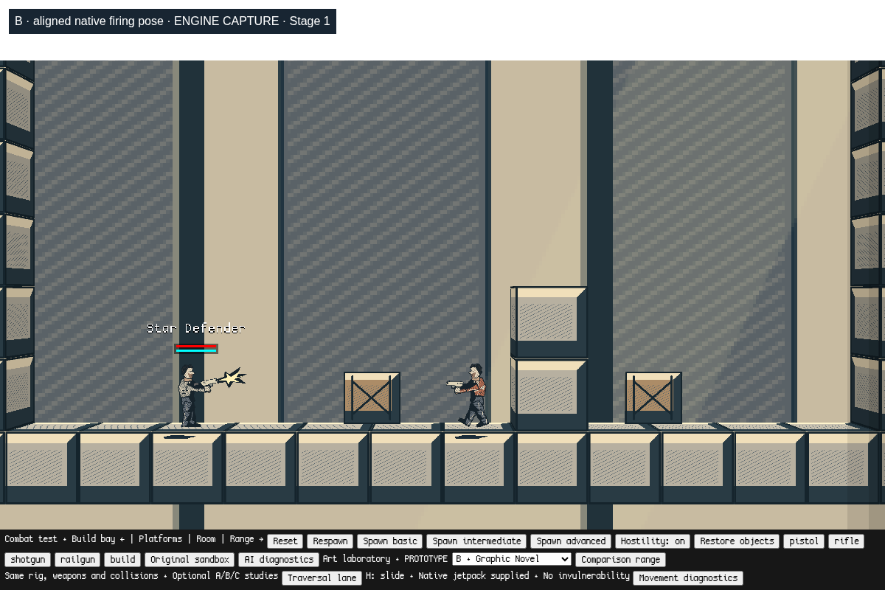
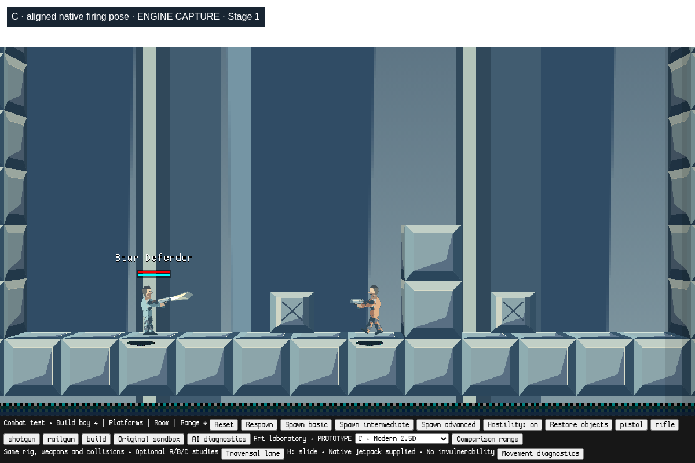

# Stage 1 checkpoint — muzzle coordinates and native crates

Based on art-direction-lab `6e63988d7577901beabed666cf2079a625b92b63`.

The projectile previously started at `GetBulletSpawnOffset()`'s torso anchor,
while the weapon was drawn from the ragdoll elbow/hand attachment using a
smoothed look angle. The procedural pistol also lacked a declared barrel anchor.
Increasing a sprite offset could not resolve these different coordinate systems.

`game/combat/weapon-pose.js` now solves the existing lower-arm attachment and
weapon muzzle metadata once for both drawing and firing. Original/A/B/C use that
same contract. The procedural pistol declares its authored barrel coordinate;
its artwork and flash map onto native muzzle metadata. This is enabled only by
the experimental combat configuration, for pistol, rifle, shotgun and railgun.
Other weapons, background fire, vehicles and original saved worlds retain their
native paths. Fresh/teleported actors with distant hand bones use the native
path until their rig catches up.

The short torso-to-muzzle segment is swept against the existing spatial hash
with the engine's `MovingRectIntersectionCheck`, native bullet bounds and native
collision filtering. An obstructed muzzle is clipped to the near side, and its
protruding flash is suppressed. Thin geometry is checked continuously rather
than sampled with the eight-unit visibility ray. Rail beams begin at the actual
projectile origin. Original critical-range anchors, damage, pellet count,
spread/recoil formulas, lifetime and velocity magnitude are retained. The base
aim ray now runs from the shared weapon attachment to the existing aim point;
that small parallax correction is necessary for visual alignment.

**Cinematic Realism A uses native cargo artwork again.** Its characters,
materials, backgrounds and lighting are retained; B and C retain their crate
prototypes. A remains the preferred artistic foundation; no setting or final
production artwork is chosen here.

## Evidence

`offline/muzzle-test.cjs` compares actual Canvas transformation matrices from the
native ragdoll draw against native `sdGun.Shoot` projectile births: 512 cases
(four styles × four weapons × four postures × eight aim directions). Frozen
posture fixtures cover standing, crouch, slide and jetpack presentation; existing
movement tests separately exercise live locomotion. The same check compares
baseline projectile properties under a controlled random sequence.

128 additional fixtures use one-unit walls/ceilings, all four weapons and
postures, and eight aim directions. They require near-side projectile births,
a native wall-impact effect and an undamaged target behind cover. No projectile
solver is mocked. Raw measurements: [stage1/validation.json](stage1/validation.json).
Regression results accompany this checkpoint in `stage1/regression.json`.

Actual engine captures, with the same range framing (prototype art):

| Original | Cinematic Realism A |
| --- | --- |
|  |  |
| Graphic Novel B | Modern 2.5D C |
|  |  |

## Run on macOS

From the checkout, run `python3 offline/launch.py --no-browser`, then open
`http://127.0.0.1:8000/?mode=combat&movement=1&art=1` in Chrome. Click **Start
combat sandbox**. The art selector switches Original/A/B/C; the existing weapon
buttons select the four test firearms. H slides; existing jump, jetpack, crouch,
firing and reload controls remain unchanged. Control-C stops the launcher.
Requires Python 3 and WebGL-capable Chrome/Chromium; no Node game server or npm
installation is needed. Retain the same localhost address/port for saves.

Software-rendered Linux Chromium automation does not establish macOS hardware
performance or subjective weapon feel. Native optional `rocket_loop.wav` is
still absent upstream; optional music remains excluded. License and attribution
files are unchanged. No source branch is merged or overwritten.
