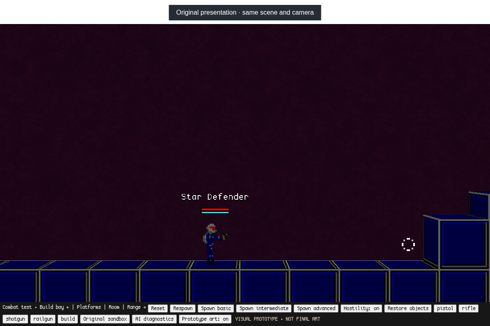
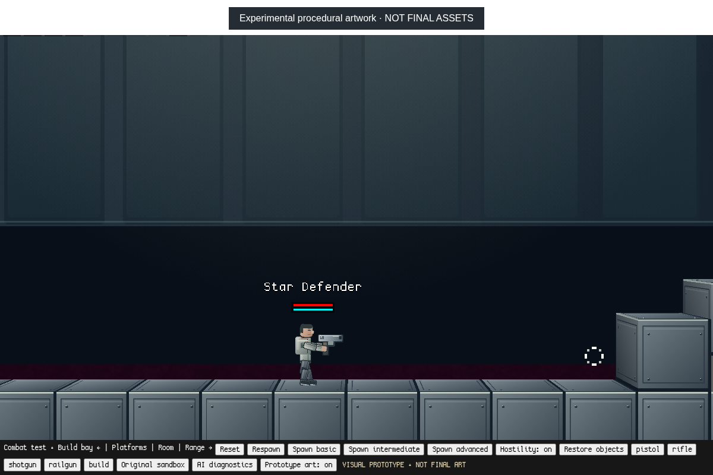
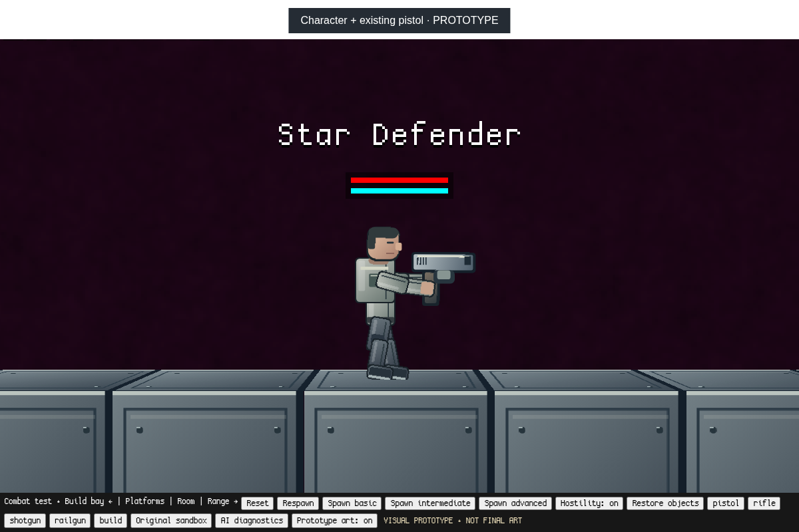

# Visual experiments — technical assessment and prototype

**Experimental artwork and effects, not final assets or an art direction.**
This branch preserves the existing simulation and offers a small optional redraw
of one player, the existing pistol, and part of the combat sandbox's starting bay.

## Compare on a phone

The first two images use the same viewport, camera, pose and frozen simulation.
The third is a separately framed close-up; it is not the performance comparison's
normal gameplay zoom. Screenshots are browser captures, not painted mock-ups.

### Original presentation


### Experimental presentation


### Character and pistol close-up


## Run on macOS

Check out `visual-experiments`, then run from the repository:

```sh
python3 offline/launch.py
```

Open **http://127.0.0.1:8000/?mode=combat&visual=1** in Chrome/Chromium and click
**Start combat sandbox**. **Prototype art: on/off** toggles the redraw immediately.
Move, jump, crouch, fire, reload or die to inspect the same original animation
and ragdoll in motion. Only the currently controlled player and its held pistol
are redrawn; other weapons, enemies and the rest of the map retain their art.

The original combat presentation remains at `/?mode=combat`; the original
offline world remains at `/`. Neither imports the prototype module. The existing
`Start Offline.command`, Python static server, save isolation, GPL notices and
music exclusions remain intact. No npm install or internet connection is needed.

## Existing pipeline: what to keep and what limits quality

- `sdRenderer.js` orchestrates camera transforms, visible entities, background /
  entity / foreground / HUD passes, depth offsets and light-source collection.
  It already offers layered scene presentation and optional 3D extrusion.
- `FakeCanvasContext.js` translates familiar canvas drawing and transforms into
  Three.js/WebGL submissions. Its WebGL renderer is created without antialiasing;
  sprite sampling also defaults to nearest-neighbor. Setting a canvas smoothing
  flag alone does not modernize this path.
- `sdAtlasMaterial.js` packs artwork into canvas-backed GPU atlases and batches
  geometry/material groups. Atlases use nearest min/mag filters and no mipmaps.
  Stock sizing is 1024 wide, up to 16384 tall outside Firefox (device limits
  apply): a full RGBA atlas is about 64 MiB before other GPU allocations. More
  source detail can therefore increase residency/upload cost even for tiny sprites.
- Atlas allocations require a one-texel gutter on every side. The initial
  1024-wide backdrop failed allocation because padding did not fit. The final
  backdrop is 512 wide. This is a practical constraint, not a renderer rewrite.
- `sdCharacter.js` supplies skin/helmet selection, palette filters, facing and
  state. `sdCharacterRagdoll.js` positions and rotates artwork at existing spring
  transforms. Its seven 32×32 limb tiles and separate helmet provide a useful
  articulated rig; most actual original limb silhouettes occupy only 2–8 pixels.
- Those logical 32-pixel crops, skin palette conventions and helmet animation
  rows prevent a simple higher-resolution PNG swap. Authored artwork needs
  explicit source-to-logical coordinate mapping and correct joint pivots.
- `sdWorld.CreateImageFromFile` loads/caches assets lazily; sprite/filter caches
  and atlas dedications reuse image content. New artwork should be cached too,
  rather than rerasterized or recolored every frame.
- Existing muzzle frames, projectiles, explosions, smoke, debris and impact
  entities already supply useful timing and feedback. Lighting is stylized
  visibility/brightness-based shading, not a general physically based material
  system. Better assets and depth composition can help before any shader work.
- Camera scale and `resolution_quality` affect output size and fill cost, not
  source detail. Changing zoom or scaling the framebuffer cannot recover the
  missing shapes in low-resolution artwork.

Keep the renderer, atlas batching, rig, effects timing and camera infrastructure.
The main modernization work is asset design, rig-compatible presentation and
scene composition. Pixel density alone does not address anatomy, silhouette,
material hierarchy or visual coherence.

## Three directions

| Direction | Visual potential / compatibility | Complexity / runtime | Assets / maintenance |
| --- | --- | --- | --- |
| A: higher-resolution 2D artwork | Strong if silhouettes, materials and proportions are authored well; the same bones and 2D collisions can remain. Raw upscaling adds little. | Low–medium integration once logical pivots/crops are specified. More texture memory and uploads; draw counts can stay similar. | Complete coordinated limb/head/damage/weapon/tile families; expensive artist time. Stable asset contracts make this maintainable. |
| B: modern layered 2D | Highest practical fit: combine authored parts with restrained depth, material separation and selected effects. Uses existing transforms, ragdolls, depth passes and particles. | Medium, staged work. Cached artwork is cheap to submit; overdraw, lights, transparent layers and atlases need budgets. No new animation framework required. | Consistent modular art plus background layers and effect sheets. Maintain a logical-pixel/pivot manifest and small optional render adapters. |
| C: selective hybrid 2D/3D | Existing perspective camera, Three.js, extrusion and depth groups support some depth already. 3D props or lighting can help selectively; full characters are not automatically better. | Medium for bounded props, high for full skinned characters/lighting. Adds geometry, depth/occlusion and potentially shadow costs. | Models, materials and animation alignment with the 2D rig. Highest pipeline/tooling and sorting burden; 2D collision silhouettes must still match gameplay. |

**Recommendation: B, using A-quality authored parts.** Keep 2D gameplay and the
current articulated rig/atlas renderer. First establish artist-authored silhouettes,
logical pivots and constrained texture budgets; then improve depth/material
composition and a few effects. Add hybrid props only where a measured visual
benefit justifies their asset and sorting cost. Do not migrate to 3D characters
or replace the renderer on the basis of this experiment.

## What the proof of concept actually changes

`game/visual/preview.js` generates and caches original canvas artwork once:
eight articulated body/head images, one pistol, one muzzle sprite, one material
tile and one low-frequency backdrop. Parts use 8× source sampling (256-pixel
canvases for 32 logical units), with antialiased contours, seams, cuffs, face and
surface highlights. This is new silhouette/material artwork, not enlarged
original pixels or a screen-wide brightness/saturation operation.

Small optional **draw-only** hooks reuse the spring transforms for body/head,
the native held-weapon transform for the pistol, and native block geometry for
selected 32×32 tiles. A separate background plane uses baked broad illumination,
recessed panels and slight parallax in a limited bay. This is not dynamic new
shadowing, normal mapping or a physically based lighting system. The baked art
bypasses palette recoloring/local shading for consistency in this prototype;
other entities keep their original treatment. Existing particles and impact
effects remain; only the pistol's drawn muzzle shape reads the normal muzzle
timer. No new simulation effects, light entities or collisions are created.

Turning the toggle off falls through to native drawing. The prototype hooks do
not change movement, jetpack, hitboxes, ragdoll springs, weapon stats, AI, damage,
building, world geometry or saves. Test-only camera/time control is confined to
the capture harness and is never installed by the playable module.

## Tests, measurements and limits

See [visual validation](validation.json), [compatibility results](compatibility.json)
and [regression results](regression.json). `offline/visual-test.cjs` captures the
images and compares player position, health, hitbox and every ragdoll bone's
position/velocity before and after toggling at frozen time. It then tests live
movement/jump, pistol ammo/reload, death/ragdoll and respawn. The compatibility
harness verifies native projectile damage/impact entities and both original
entry points without loading the module. The preserved combat suite exercises
weapons, AI, destruction, construction and resets with the original presentation.

Performance samples are interleaved original/prototype calls in the same frozen
close-up after warm-up. `validation.json` records every sample, not a claimed FPS.
Across five measured calls per variant, original median/mean were **0.8 / 1.24 ms**;
prototype median/mean were **2.0 / 1.92 ms**. The prototype cost more CPU time in
this sample; it is not presented as a performance optimization.
This Linux Chromium run uses ANGLE Vulkan **SwiftShader software rendering**.
Timing around `Render` measures CPU submission/call cost and can exclude deferred
GPU execution. It does not measure input latency, sustained FPS, cold uploads or
macOS GPU behavior. The sample is small and noisy; no performance improvement is
claimed. Larger source textures and additional layers can cost more. Test on
Apple Silicon/Intel macOS before deciding atlas budgets, filtering or shadows.

This is a pipeline demonstration, not shipping character art. Joint overlaps,
anatomy, face expression/blink, injured/gore variants, skin customization,
lighting integration, remaining weapon/jetpack artwork and consistent NPC art
would need production work. The prototype does not author those variants. It
is a bounded scenery patch: extreme zoom/depth clipping or looking outside it
can reveal the unchanged legacy background, as the separate close-up does. It
keeps nearest sampling for legacy/UI assets; a future linear-sampled art bucket
with adequate gutters may help, but globally filtering the existing atlas would
blur fonts/pixel art and may introduce edge bleeding. The inherited scene's
original setting-specific assets outside the small bay are unchanged, not a
choice of future setting. No missions, storyline or final identity are introduced.

## Artwork and licensing

The procedural prototype artwork and its source are original to this branch and
distributed under the repository's GPL-3.0 terms. No generated art service,
external image, external font, downloaded art or new runtime dependency is used.
All existing project and third-party license notices remain. Screenshots show
the original game engine/assets alongside clearly labeled prototype work.
